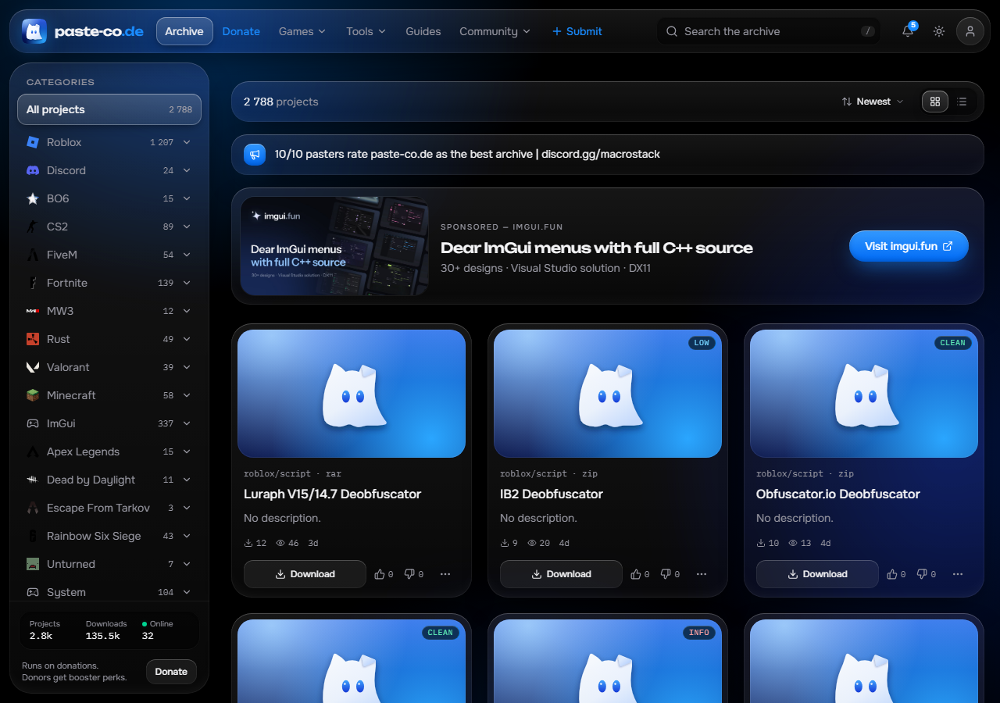
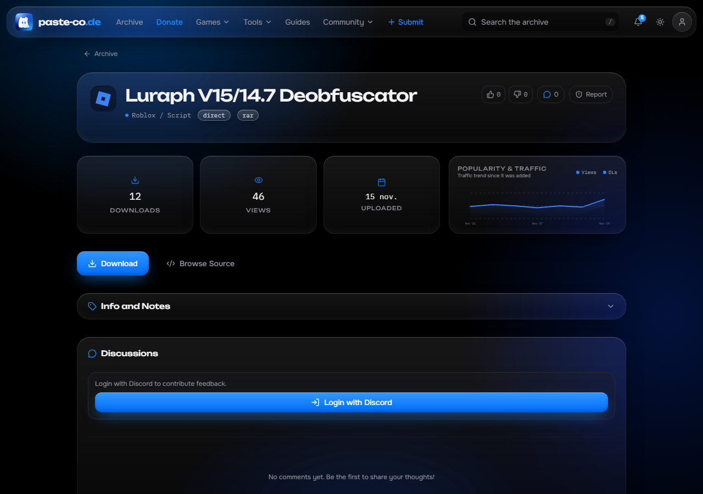
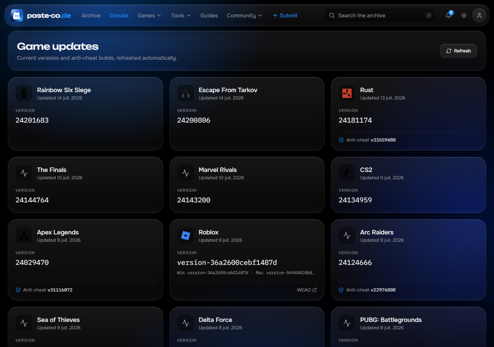
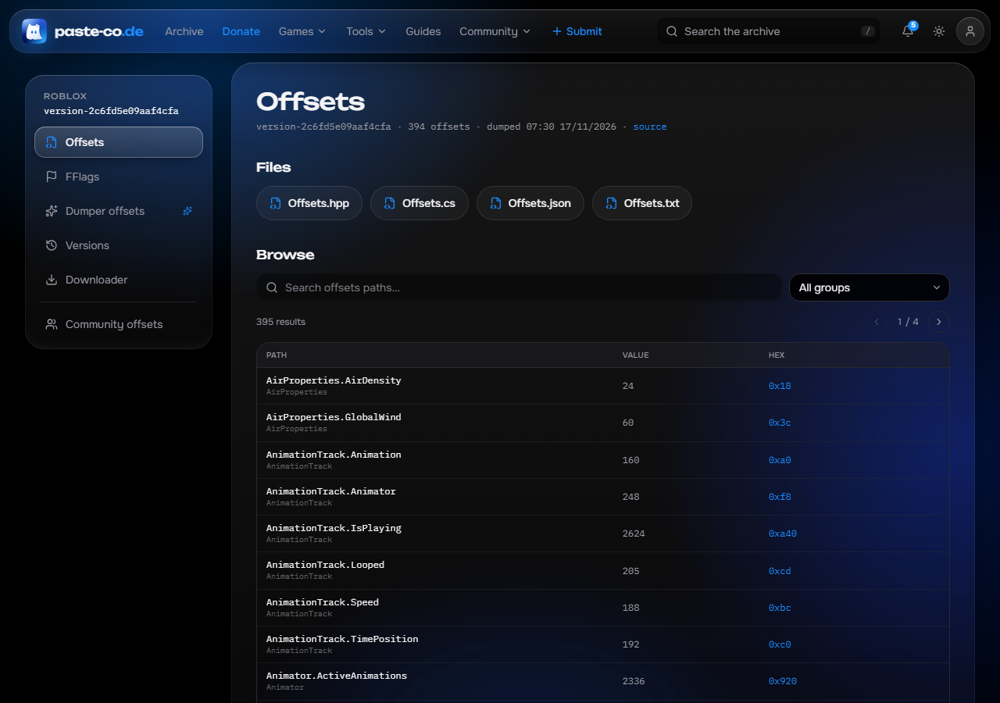
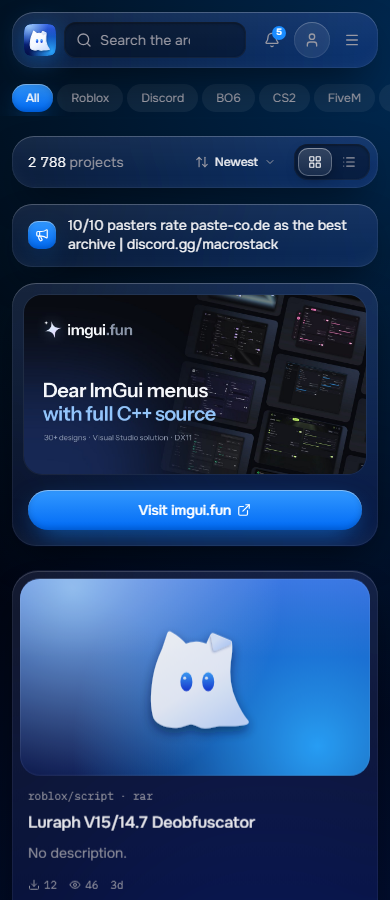

<div align="center">


# paste-co.de — Clone

**Réplique statique complète** de l'archive de sources et du hub communautaire [paste-co.de](https://paste-co.de),
reconstruite avec Next.js 16, React 19 et Tailwind CSS v4.

[](https://nextjs.org/)
[](https://react.dev/)
[](https://www.typescriptlang.org/)
[](https://tailwindcss.com/)
[](LICENSE)

</div>

---

## Aperçu

| Archive | Fiche projet |
| :---: | :---: |
|  |  |
| **Game updates** | **Roblox** |
|  |  |

<p align="center">
  
  <br />
  <sub>Rendu mobile — 390 px</sub>
</p>

## Le projet

Ce dépôt reproduit l'intégralité du site public **paste-co.de** : l'archive de projets, les fiches détaillées,
le suivi des jeux et de leurs builds anti-triche, le hub Roblox, les guides, le forum, les outils communautaires
et les pages légales.

L'objectif est la **fidélité visuelle et structurelle** : mêmes routes, mêmes contenus, mêmes assets, mêmes
composants d'interface (header flottant, surfaces en verre, cartes, tableaux, onglets, modales), au pixel près,
en desktop comme en mobile.

- **2 788 projets** dans l'archive, avec recherche, filtres par catégorie, 5 tris, vue grille/liste et pagination par 24.
- **27 jeux** suivis avec versions, dates de mise à jour, builds anti-triche et liens vers les sources.
- **15 273 FFlags Roblox** et 394 offsets, chargés à la demande dans le hub Roblox.
- **17 guides** longs (reverse engineering, offsets, injection, anti-triche, noyau Windows…).
- **Forum complet** : 5 catégories, sujets, réponses, avatars Discord et horodatages.
- **Outils communautaires** : offsets partagés, soumissions, demandes, scanner.
- **Pages donateur** : dons, accès Tools / Proxy / MCP, états connecté/déconnecté.
- **Pages légales** : confidentialité, conditions, cookies, sécurité — avec leur pied de page d'origine.
- **UI** : thème clair/sombre, recherche globale avec résultats en direct, 404 personnalisée, responsive mobile-first.

## Stack

| Technologie | Usage |
| --- | --- |
| [Next.js 16](https://nextjs.org/) | App Router, routes dynamiques, rendu serveur |
| [React 19](https://react.dev/) | Composants serveur et clients |
| [TypeScript](https://www.typescriptlang.org/) | Mode strict, aucun `any` |
| [Tailwind CSS 4](https://tailwindcss.com/) | Tokens oklch, thèmes et surfaces « glass » |
| [shadcn/ui](https://ui.shadcn.com/) + [Base UI](https://base-ui.com/) | Primitives d'interface |
| [Lucide](https://lucide.dev/) | Icônes, complétées par les SVG extraits du site |
| Snapshots JSON | Données statiques, sans appel API à l'exécution |

## Démarrage

**Prérequis :** [Node.js](https://nodejs.org/) 24 ou supérieur.

```bash
npm install
npm run dev
```

Ouvrir [http://localhost:3000](http://localhost:3000).

### Scripts

| Commande | Description |
| --- | --- |
| `npm run dev` | Serveur de développement |
| `npm run build` | Build de production |
| `npm run start` | Serveur de production |
| `npm run lint` | ESLint |
| `npm run typecheck` | Vérification TypeScript |
| `npm run check` | Lint + typecheck + build |

## Routes

| Route | Page |
| --- | --- |
| `/` | Archive, catégories, tri, recherche et pagination |
| `/games` | Versions des jeux et builds anti-triche |
| `/roblox` | Offsets, FFlags, dumper, versions, téléchargements |
| `/community-offsets` | Dumps d'offsets partagés par la communauté |
| `/guides` · `/guides/[slug]` | Index et 17 guides |
| `/forums` · `/forums/[category]` · `/forums/topic/[id]` | Forum, catégories et sujets |
| `/project/[id]` · `/project/[id]/source` | Fiche projet et explorateur de sources |
| `/submissions` · `/requests` · `/scanner` | Soumissions, demandes et scanner |
| `/donate` | Dons et avantages donateur |
| `/tools` · `/proxy` · `/mcp` | Outils réservés aux donateurs (démo) |
| `/privacy` · `/terms` · `/cookies` · `/safety` | Pages légales |
| `/community` | Redirection vers `/submissions` |

## Structure

```text
src/
  app/                  # Une route par dossier (App Router)
  components/
    site/               # Header, footer, cartes, tableaux, clients interactifs
    ui/                 # Primitives shadcn/ui
  content/              # Guides et pages légales (HTML nettoyé + métadonnées)
  data/                 # Snapshots JSON : projets, jeux, Roblox, forum, recherche
  lib/                  # Accès aux données, formatage, utilitaires
  types/                # Interfaces TypeScript
public/
  brand/                # Logo et favicon
  game-icons/           # Icônes des jeux extraites du site
  sponsors/             # Bannière du sponsor
  fonts/                # Polices du site
docs/
  research/paste-co.de/ # Pages, CSS, API et captures du site source
  design-references/    # Captures de vérification et rendu mobile
scripts/pastecode/      # Scripts d'extraction et de miroir des assets
```

## Données et fidélité

Les données publiques du site source ont été capturées puis figées dans `src/data/` et `src/content/`.
**Aucune requête n'est faite vers `paste-co.de` au runtime** : le clone fonctionne hors ligne, à l'exception
des liens externes d'origine (Discord, téléchargements bruts, sources des projets).

Les comparaisons visuelles ont été menées aux largeurs **912 / 1128 px** en desktop et **390 px** en mobile.
Les captures de référence et les preuves d'inspection sont conservées dans `docs/`.

## Limites assumées

Ce dépôt est une **démonstration statique** du site, pas une réplique de son backend :

- Les téléchargements, votes, signalements, uploads et connexions Discord passent par une modale `DemoAction`
  ou par l'état « déconnecté » d'origine. Aucun binaire, fichier ou compte n'est créé.
- Les zones réservées aux donateurs affichent leur page d'accès, sans débloquer de contenu.
- L'explorateur de sources présente la structure et les métadonnées, sans contenu réel des archives.
- Le graphique de trafic des projets est généré localement : les données d'origine ne sont pas publiques.
- Les compteurs et horodatages reflètent le moment de la capture.

## Déploiement

Le projet se déploie tel quel sur [Vercel](https://vercel.com/) ou tout hôte Node.js :

```bash
npm run build
npm run start
```

## Avertissement

Ce projet est un exercice de reconstruction d'interface à but éducatif. Il n'est **ni affilié ni approuvé**
par paste-co.de. La marque, les textes, les assets et les contenus appartiennent à leurs propriétaires respectifs.
Aucun binaire de triche n'est distribué par ce dépôt ; les actions sensibles sont volontairement neutralisées.

## Licence

Code sous [MIT](LICENSE). Les contenus et assets du site original restent la propriété de leurs auteurs.
